MB 588 Final Project
================
Jenna Kraemer
2025-12-9

# Summary of data sources

This section summarizes the paper chosen for this project and where the
data is located.

### Chosen Paper

The paper selected for this project is *Utilization of multiple
microbial tools to evaluate efficacy of restoration strategies to
improve recreational water quality at a Lake Michigan Beach (Racine,
WI)* by Kinzelman *et al* (2020). The study uses Illumina 16S rRNA gene
sequencing in the methods to analyze microbial communities from
environmental samples. I chose this paper because it is related to my
research field in recreational water quality and it uses other methods
such as microbial source tracking which I also use.

### Hypothesis

The expected results from this re-analysis are that there are
significant differences between the taxonomy found at each location. It
is also expected that sites with similar characteristics will have
similar taxonomy and alpha diversity metrics.

### NCBI SRA

The sequencing data from the paper is located under BioProject
[PRJNA640667](https://www.ncbi.nlm.nih.gov/bioproject/?term=(PRJNA640667)%20AND%20bioproject_sra%5Bfilter%5D%20NOT%20bioproject_gap%5Bfilter%5D)
and accession numbers SAMN15327323- SAMN15327376 for the samples.

### How the data is reported

The sequencing files were uploaded as merged reads when they are
actually 2 × 250 paired end reads on a MiSeq Illumina. This caused my
pre-processing to treat the samples as single-end reads.

------------------------------------------------------------------------

# Summary of re-analysis plan

### Original analysis

The original paper utilizes the following methods for their analysis,

**Pre-processing**

- QIIME (version 1.9.1) to analyze the 16S rRNA sequencing data
- clustered the data into OTUs
- Greengenes dataset (version 13_5) for taxa assignment
- Rarified the dataset

**Statistical analysis**

Alpha diversity

- Shannon (non-parametric *t*-tests with 999 permutations)
- Chaol
- Simpson
- PD whole tree

Beta diversity

- Weighted and un-weighted unifrac

- Non-phylogenetic distances (Jaccard and Bray Curtis)

- 999 permutations of PERMANOVA and PERMDISP

Differential analysis

- LEfSe

### Plan for re-analysis

For my re-analysis, I proposed to run the data on DADA2 to get ASVs and
perform taxa assignment using the SILVA dataset. This is because ASVs
produce higher resolution results to get better taxa assignments. I
chose the SILVA dataset instead of Greengenes because it is more up to
date and better for bacterial assignment. For statistical analysis, I
proposed to use Shannon index for an alpha diversity metric and CLR
transformed data and euclidean distances to visualize beta diversity
with a PCoA. I plan to reproduce some visuals from the original paper to
compare the results with the differing analysis.

**Pre-processing**

- DADA2 to get ASVs

- Taxonomic assignment using SILVA (version 138.2)

**Statistical Analysis**

Alpha Diversity

- Shannon (non-parametric *t*-tests with 999 permutations)

Beta Diversity

- PCoA with euclidean distances of CLR transformed data

Differential Analysis

- MaAsLin3

### Feedback from Updated Proposal

After submitting my updated proposal, it was recommended that I also
perform a PERMANOVA and differential abundance analysis. The original
paper used LEfSe which has a high false positive rate so I plan on usng
MaAsLin3 for my analysis.

### Feedback from presentation

------------------------------------------------------------------------

# Results Summary

The main objective of this re-analysis was to determine
differences/similarities in microbial community compositions between
locations sampled from the Kinzelman *et al.* paper. My analysis showed
that the IEB Overflow had the highest range of alpha diversity which was
also seen in the analysis from the paper but the Shannon Diversity
calculated in the paper was a lot higher than my values. The PERMANOVA
yielded a p-value of 0.001 for the location variable which was the same
as the value calculated in the paper. There were 47 unique phyla
identified and

------------------------------------------------------------------------

# Re-analysis

## Load libraries

``` r
library(dada2)
library(ShortRead)
library(Biostrings)
library(tidyverse)
library(data.table)
library(vegan)
library(RRPP)
library(coin)
library(multcompView)
```

## DADA2

### Assign path for fastq files

``` r
path <- "/Users/jennakraemer/Courses-MB588_BIT588-jkraeme/final_project/fastq" 
list.files(path) # Check files in path
```

    ##  [1] "cut"               "cutadapt"          "filtN"             "SRR12063182.fastq" "SRR12063183.fastq"
    ##  [6] "SRR12063184.fastq" "SRR12063185.fastq" "SRR12063186.fastq" "SRR12063187.fastq" "SRR12063188.fastq"
    ## [11] "SRR12063189.fastq" "SRR12063190.fastq" "SRR12063191.fastq" "SRR12063192.fastq" "SRR12063193.fastq"
    ## [16] "SRR12063194.fastq" "SRR12063195.fastq" "SRR12063196.fastq" "SRR12063197.fastq" "SRR12063198.fastq"
    ## [21] "SRR12063199.fastq" "SRR12063200.fastq" "SRR12063201.fastq" "SRR12063202.fastq" "SRR12063203.fastq"
    ## [26] "SRR12063204.fastq" "SRR12063205.fastq" "SRR12063206.fastq" "SRR12063207.fastq" "SRR12063208.fastq"
    ## [31] "SRR12063209.fastq" "SRR12063210.fastq" "SRR12063211.fastq" "SRR12063212.fastq" "SRR12063213.fastq"
    ## [36] "SRR12063214.fastq" "SRR12063215.fastq" "SRR12063216.fastq" "SRR12063217.fastq" "SRR12063218.fastq"
    ## [41] "SRR12063219.fastq" "SRR12063220.fastq" "SRR12063221.fastq" "SRR12063222.fastq" "SRR12063223.fastq"
    ## [46] "SRR12063224.fastq" "SRR12063225.fastq" "SRR12063226.fastq" "SRR12063227.fastq" "SRR12063228.fastq"
    ## [51] "SRR12063229.fastq" "SRR12063230.fastq" "SRR12063231.fastq" "SRR12063232.fastq" "SRR12063233.fastq"
    ## [56] "SRR12063234.fastq" "SRR12063235.fastq"

This lists the fastq files. Normally it would be separated into forward
and reverse reads but since the SRA files are single-end reads, they are
all together.

``` r
fnFs <- sort(list.files(path, pattern = ".fastq", full.names = TRUE))
```

### Identify primers

The paper uses V3-V4 region primers (343-forward TAC GGR AGG CAG CAG and
804-reverse CTA CCR GGG TAT CTA ATC C).

``` r
FWD <- "TACGGRAGGCAGCAG"
REV <- "CTACCRGGGTATCTAATCC" 

allOrients <- function(primer) {
    # Create all orientations of the input sequence
    require(Biostrings)
    dna <- DNAString(primer)  # The Biostrings works w/ DNAString objects rather than character vectors
    orients <- c(Forward = dna, Complement = Biostrings::complement(dna), Reverse = Biostrings::reverse(dna),
        RevComp = Biostrings::reverseComplement(dna))
    return(sapply(orients, toString))  # Convert back to character vector
}
FWD.orients <- allOrients(FWD)
REV.orients <- allOrients(REV)
FWD.orients
```

    ##           Forward        Complement           Reverse           RevComp 
    ## "TACGGRAGGCAGCAG" "ATGCCYTCCGTCGTC" "GACGACGGARGGCAT" "CTGCTGCCTYCCGTA"

### Prefiltering

``` r
fnFs.filtN <- file.path(path, "filtN", basename(fnFs)) # Put N-filtered files in filtN/ subdirectory
filterAndTrim(fnFs, fnFs.filtN, maxN = 0, multithread = TRUE)
```

``` r
# Count how many reads contain the primer sequence
primerHits <- function(primer, fn) {
  nhits <- vcountPattern(primer, sread(readFastq(fn)), fixed = FALSE)
  return(sum(nhits > 0))
}

# Run primer detection on all orientations of your forward primer
rbind(FWD.Reads = sapply(FWD.orients, primerHits, fn = fnFs.filtN[[1]]),
      REV.Reads = sapply(REV.orients, primerHits, fn = fnFs.filtN[[1]]))
```

    ##           Forward Complement Reverse RevComp
    ## FWD.Reads   64266          0       0       0
    ## REV.Reads       0          0       0   60660

### Cutadapt to trim primers

``` r
cutadapt <- "/opt/anaconda3/envs/cutadapt/bin/cutadapt" 
system2(cutadapt, args = "--version") # Run shell commands from R
```

``` r
# Define output directory
path.cut <- file.path(path, "cutadapt")
if (!dir.exists(path.cut)) dir.create(path.cut)

# Input and output file paths
fnFs.cut <- file.path(path.cut, basename(fnFs))

# Reverse complements for completeness
FWD.RC <- dada2:::rc(FWD)
REV.RC <- dada2:::rc(REV)

# Cutadapt trimming flags for single-end reads:
# -g = 5' (forward) primer
# -a = 3' (reverse complement of reverse primer)
R1.flags <- c("-g", FWD, "-a", REV.RC)

# Run cutadapt over each FASTQ file
for (i in seq_along(fnFs)) {
  system2(cutadapt,
          args = c(R1.flags,
                   "-n", 2,                # remove both primers if both present
                   "-o", fnFs.cut[i],      # output file
                   fnFs.filtN[i]))         # input file
}
```

### Checking that primer sequences were removed

``` r
rbind(FWD.ForwardReads = sapply(FWD.orients, primerHits, fn = fnFs.cut[[1]]), 
      REV.ForwardReads = sapply(REV.orients, primerHits, fn = fnFs.cut[[1]]))
```

    ##                  Forward Complement Reverse RevComp
    ## FWD.ForwardReads       0          0       0       0
    ## REV.ForwardReads       0          0       0       0

``` r
# Forward and reverse fastq filenames have the format:
cutFs <- sort(list.files(path.cut, pattern = ".fastq", full.names = TRUE))

# Extract sample names, assuming filenames have format:
get.sample.name <- function(fname) tools::file_path_sans_ext(basename(fname))
sample.names <- unname(sapply(cutFs, get.sample.name))
head(sample.names)
```

    ## [1] "SRR12063182" "SRR12063183" "SRR12063184" "SRR12063185" "SRR12063186" "SRR12063187"

### Checking quality

``` r
plotQualityProfile(cutFs[1:2])
```

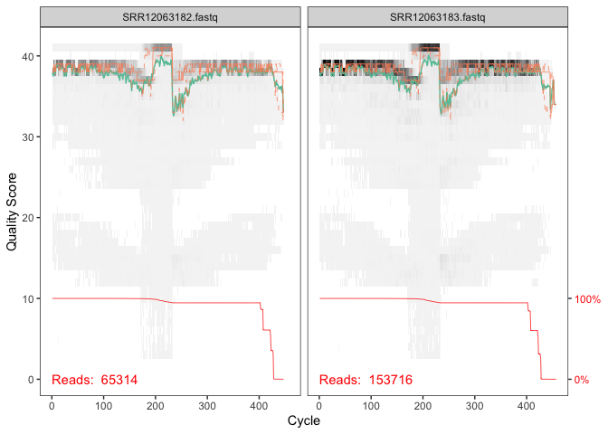<!-- -->

### Filter and Trim Reads

``` r
filtFs <- file.path(path.cut, "filtered", basename(cutFs))

out <- filterAndTrim(
  cutFs, filtFs,
  maxN = 0,
  maxEE = 2,         # single value, not c(1,2) because single reads
  truncQ = 1,
  minLen = 50,
  rm.phix = TRUE,
  compress = TRUE,
  multithread = TRUE
)
head(out)
```

    ##                   reads.in reads.out
    ## SRR12063182.fastq    65314     64261
    ## SRR12063183.fastq   153716    151332
    ## SRR12063184.fastq   156243    153712
    ## SRR12063185.fastq    94369     92939
    ## SRR12063186.fastq    40196     39417
    ## SRR12063187.fastq    88525     86964

### Learning error rates

``` r
errF <- learnErrors(filtFs, multithread = TRUE)
```

    ## 149988508 total bases in 369305 reads from 3 samples will be used for learning the error rates.

**Sanity check for estimated error rates**

``` r
plotErrors(errF, nominalQ = TRUE)
```

### Sample Inference

``` r
dadaFs <- dada(filtFs, err = errF, multithread = TRUE)
```

### Construct Sequence Table

``` r
seqtab <- makeSequenceTable(dadaFs)
dim(seqtab)
```

### Remove chimeras

``` r
seqtab.nochim <- removeBimeraDenovo(seqtab, method="consensus", multithread=TRUE, verbose=TRUE)

table(nchar(getSequences(seqtab.nochim)))
```

**Check number of reads at each step**

``` r
getN <- function(x) sum(getUniques(x))
track <- cbind(out, sapply(dadaFs, getN),
    rowSums(seqtab.nochim))
# If processing a single sample, remove the sapply calls: e.g. replace
# sapply(dadaFs, getN) with getN(dadaFs)
colnames(track) <- c("input", "filtered", "denoisedF", "nonchim")
rownames(track) <- sample.names
head(track)

track <- as.data.frame(track)

summarize(track, 
          input = sum(input),
          output = sum(nonchim), 
          percent = output/input)
```

88% of raw reads passed filtering.

``` r
knitr::include_graphics("figures/tracking_reads.png")
```


### Assign taxonomy

``` r
unite.ref <- "/Users/jennakraemer/Courses-MB588_BIT588-jkraeme/14169026/silva_nr99_v138.2_toSpecies_trainset.fa.gz" 
taxa <- assignTaxonomy(seqtab.nochim, unite.ref, multithread = TRUE, tryRC = TRUE)
```

## Making ps object

``` r
ASV_data <- seqtab.nochim 

TAX_data <- taxa

SAM_data <- read_csv("/Users/jennakraemer/Courses-MB588_BIT588-jkraeme/final_project/SraRunTable.csv")

# Check orientations and content of data
colnames(ASV_data[,1:5])
anyNA(ASV_data) 
str(TAX_data)
anyNA(SAM_data)
all(colnames(ASV_data)==rownames(TAX_data))
anyNA(SAM_data)
all(rownames(SAM_data)==rownames(ASV_data)) 

# Make the rownames match
rownames(ASV_data) <- sub("\\.fastq$", "", rownames(ASV_data))

# Make sample names row names in sample data
SAM_data <- as.data.frame(SAM_data)
rownames(SAM_data) <- SAM_data$Run
SAM_data$Run <- NULL

# convert data files to phyloseq formats
ASV <- phyloseq::otu_table(base::as.matrix(ASV_data), taxa_are_rows = FALSE) 
SAM <- phyloseq::sample_data(SAM_data)
TAX <- phyloseq::tax_table(base::as.matrix(TAX_data))

ps <- phyloseq::phyloseq(ASV, SAM, TAX) 

# Save all outputs
write.csv(seqtab.nochim, file = 'asv_table.csv')
write.csv(taxa, file = 'TAX_table.csv')
write.csv(SAM_data, file = 'SAM_table.csv')
saveRDS(ps, file = "/Users/jennakraemer/Courses-MB588_BIT588-jkraeme/final_project/ps.RDS")
```

## Mumu

``` r
# rename ASVs and create refseq 
dna <- Biostrings::DNAStringSet(phyloseq::taxa_names(ps))
names(dna) <- phyloseq::taxa_names(ps)
ps <- phyloseq::merge_phyloseq(ps, dna)
phyloseq::taxa_names(ps) <- paste0("ASV", seq(phyloseq::ntaxa(ps)))
ps
```

Bella helped me with this portion. I picked a threshold of 0.99 to be in
between typical 97% and raw ASVs.

``` r
mumu_asv <- MiscMetabar::mumu_pq(
  ps,
  nproc = 4,
  id = 0.99,
  vsearchpath = "/opt/anaconda3/bin/vsearch",
  mumupath = "/Users/jennakraemer/mumu/mumu",
  verbose = TRUE,
  clean_pq = TRUE,
  keep_temporary_files = FALSE
)

# Save outputs
ps_mumu <- mumu_asv$new_physeq
mumu_results <- mumu_asv$mumu_results
write.csv(mumu_results, "/Users/jennakraemer/Courses-MB588_BIT588-jkraeme/final_project/mumu_results.csv")
saveRDS(ps_mumu, file = "/Users/jennakraemer/Courses-MB588_BIT588-jkraeme/final_project/mumu_ps.RDS")
```

### Reload Mumu ps object and inspect data

``` r
ps_mumu <- readRDS("/Users/jennakraemer/Courses-MB588_BIT588-jkraeme/final_project/mumu_ps.RDS")

# Number of taxa
phyloseq::ntaxa(ps_mumu)
```

    ## [1] 6072

``` r
# Number of samples
phyloseq::nsamples(ps_mumu) 
```

    ## [1] 54

``` r
# Observing sample data of ps object
# head(phyloseq::sample_data(ps_mumu))

# Sample variables
phyloseq::sample_variables(ps_mumu)
```

    ##  [1] "Assay.Type"                     "AvgSpotLen"                     "Bases"                         
    ##  [4] "BioProject"                     "BioSample"                      "BioSampleModel"                
    ##  [7] "Bytes"                          "Center.Name"                    "Collection_Date"               
    ## [10] "Consent"                        "DATASTORE.filetype"             "DATASTORE.provider"            
    ## [13] "DATASTORE.region"               "Depth"                          "env_broad_scale"               
    ## [16] "env_local_scale"                "env_medium"                     "Experiment"                    
    ## [19] "geo_loc_name_country"           "geo_loc_name_country_continent" "geo_loc_name"                  
    ## [22] "Instrument"                     "lat_lon"                        "Library.Name"                  
    ## [25] "LibraryLayout"                  "LibrarySelection"               "LibrarySource"                 
    ## [28] "Organism"                       "Platform"                       "ReleaseDate"                   
    ## [31] "create_date"                    "version"                        "Sample.Name"                   
    ## [34] "SRA.Study"

``` r
# Sample sums
head(phyloseq::sample_sums(ps_mumu))
```

    ## SRR12063182 SRR12063183 SRR12063184 SRR12063185 SRR12063186 SRR12063187 
    ##       59529      141597      143574       86298       31626       74598

``` r
# Taxa names
head(phyloseq::taxa_names(ps_mumu))
```

    ## [1] "ASV1" "ASV2" "ASV4" "ASV3" "ASV5" "ASV7"

``` r
# check for singletons
any(phyloseq::taxa_sums(ps_mumu)==1)
```

    ## [1] FALSE

``` r
# check for zero sums
phyloseq::sample_sums(ps_mumu) 
```

    ## SRR12063182 SRR12063183 SRR12063184 SRR12063185 SRR12063186 SRR12063187 SRR12063188 SRR12063189 
    ##       59529      141597      143574       86298       31626       74598       59540       36253 
    ## SRR12063190 SRR12063191 SRR12063192 SRR12063193 SRR12063194 SRR12063195 SRR12063196 SRR12063197 
    ##      129406      104263       70530       78497       55493      136253       29374      128190 
    ## SRR12063198 SRR12063199 SRR12063200 SRR12063201 SRR12063202 SRR12063203 SRR12063204 SRR12063205 
    ##       45548       53166      135886      160864       97907       41684       61715       47347 
    ## SRR12063206 SRR12063207 SRR12063208 SRR12063209 SRR12063210 SRR12063211 SRR12063212 SRR12063213 
    ##       68107       55766       24221       48913       45492       53013       63865       49299 
    ## SRR12063214 SRR12063215 SRR12063216 SRR12063217 SRR12063218 SRR12063219 SRR12063220 SRR12063221 
    ##       61018       27678       42172       54642       97329      133376      157879       87044 
    ## SRR12063222 SRR12063223 SRR12063224 SRR12063225 SRR12063226 SRR12063227 SRR12063228 SRR12063229 
    ##      148508       68953       98597       99805       80194       83212       70663       93561 
    ## SRR12063230 SRR12063231 SRR12063232 SRR12063233 SRR12063234 SRR12063235 
    ##      138317       75399       66404       87177       48987       42413

------------------------------------------------------------------------

## Alpha Diversity

### Calculate Shannon Diversity Index

``` r
alpha <- phyloseq::estimate_richness(ps_mumu, split=TRUE, measures=c("Shannon")) 
head(alpha)
```

    ##              Shannon
    ## SRR12063182 4.152986
    ## SRR12063183 4.389874
    ## SRR12063184 4.475341
    ## SRR12063185 4.524162
    ## SRR12063186 3.000772
    ## SRR12063187 3.159196

### Statistical analysis of alpha diversity

The paper did non-parametric t-tests with 999 permutations so I copied
that to be able to compare their statistical results with mine in
relation to the alpha diversity.

``` r
# Reformat SAM data
SAM_data <- read_csv("/Users/jennakraemer/Courses-MB588_BIT588-jkraeme/final_project/SraRunTable.csv")
# Make sample names row names in sample data
SAM_data <- as.data.frame(SAM_data)
rownames(SAM_data) <- SAM_data$Run
SAM_data$Run <- NULL
SAM <- phyloseq::sample_data(SAM_data)
SAM2 <- merge(SAM, alpha, by="row.names", all=TRUE) 
# Factor locations
SAM2$env_local_scale <- as.factor(SAM2$env_local_scale)

# This code was generated by ChatGPT to loop through all pairs of non-parametric t-tests
groups <- levels(SAM2$env_local_scale)
pairs <- combn(groups, 2, simplify = FALSE)

results <- lapply(pairs, function(p) {
  subset_data <- SAM2[SAM2$env_local_scale %in% p, ]
  
  test <- oneway_test(
    Shannon ~ env_local_scale,
    data = subset_data,
    distribution = approximate(nresample = 999)
  )
  
  data.frame(
    group1 = p[1],
    group2 = p[2],
    p_value = pvalue(test)
  )
})

pairwise_df <- do.call(rbind, results)
pairwise_df$padj <- p.adjust(pairwise_df$p_value, method = "fdr")
pairwise_df
```

    ##          group1       group2      p_value       padj
    ## 1   Harbor_Wall IEB_Overflow  0.295295295 0.33998284
    ## 2   Harbor_Wall           N1  0.317317317 0.33998284
    ## 3   Harbor_Wall           N3  0.126126126 0.23648649
    ## 4   Harbor_Wall          REC <0.001001001 0.00000000
    ## 5   Harbor_Wall     RR_Mouth  0.033033033 0.08258258
    ## 6  IEB_Overflow           N1  0.227227227 0.30985531
    ## 7  IEB_Overflow           N3  0.197197197 0.29579580
    ## 8  IEB_Overflow          REC  0.021021021 0.06306306
    ## 9  IEB_Overflow     RR_Mouth  0.119119119 0.23648649
    ## 10           N1           N3  0.602602603 0.60260260
    ## 11           N1          REC <0.001001001 0.00000000
    ## 12           N1     RR_Mouth  0.167167167 0.27861195
    ## 13           N3          REC <0.001001001 0.00000000
    ## 14           N3     RR_Mouth  0.257257257 0.32157157
    ## 15          REC     RR_Mouth  0.012012012 0.04504505

### Visualize Shannon over Location

``` r
# Chat GPT was used to troubleshoot some of the errors I came across with this code chunk and adding letters to the graph
# Get unique groups
groups <- unique(c(pairwise_df$group1, pairwise_df$group2))

# Initialize matrix
p_matrix <- matrix(1, nrow = length(groups), ncol = length(groups),
                   dimnames = list(groups, groups))

# Fill in pairwise comparisons
for (i in 1:nrow(pairwise_df)) {
  g1 <- pairwise_df$group1[i]
  g2 <- pairwise_df$group2[i]
  p  <- pairwise_df$padj[i]     #adjusted p-values
  
  p_matrix[g1, g2] <- p
  p_matrix[g2, g1] <- p
}

p_matrix
```

    ##              Harbor_Wall IEB_Overflow        N1        N3        REC   RR_Mouth
    ## Harbor_Wall   1.00000000   0.33998284 0.3399828 0.2364865 0.00000000 0.08258258
    ## IEB_Overflow  0.33998284   1.00000000 0.3098553 0.2957958 0.06306306 0.23648649
    ## N1            0.33998284   0.30985531 1.0000000 0.6026026 0.00000000 0.27861195
    ## N3            0.23648649   0.29579580 0.6026026 1.0000000 0.00000000 0.32157157
    ## REC           0.00000000   0.06306306 0.0000000 0.0000000 1.00000000 0.04504505
    ## RR_Mouth      0.08258258   0.23648649 0.2786119 0.3215716 0.04504505 1.00000000

``` r
letters <- multcompLetters(p_matrix)$Letters # Assign letters to variable
letters
```

    ##  Harbor_Wall IEB_Overflow           N1           N3          REC     RR_Mouth 
    ##          "a"         "ab"          "a"          "a"          "b"          "a"

``` r
# Create dataframe for the letters with their corresponding locations
letters_df <- data.frame(
  env_local_scale = names(letters),
  label = letters
)

stats <- SAM2 %>%
  group_by(env_local_scale) %>% # Group by location
  summarize(maxY = max(Shannon, na.rm = TRUE))
letters_df <- merge(letters_df, stats, by="env_local_scale")

# Box plot with shannon diversity for each location and letters for statistical differences
ggplot(SAM2, aes(x = env_local_scale, y = Shannon)) +
  geom_boxplot() +
  theme_bw() +
  geom_text(data = letters_df,
            aes(x = env_local_scale, y = maxY + 0.1, label = label),
            size = 5) +
  labs(x = "Sample Location") +
  theme(axis.text.x = element_text(size = 14, angle = 45, hjust = 1),
        axis.text.y = element_text(size = 12), 
        axis.title.y = element_text(size = 13), 
        axis.title.x = element_text(size = 13))
```

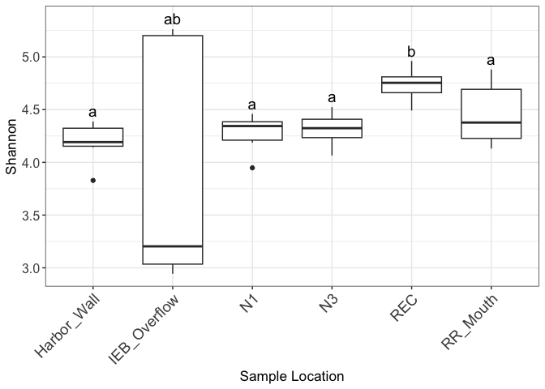<!-- -->

### Paper’s Alpha Diversity Figure

``` r
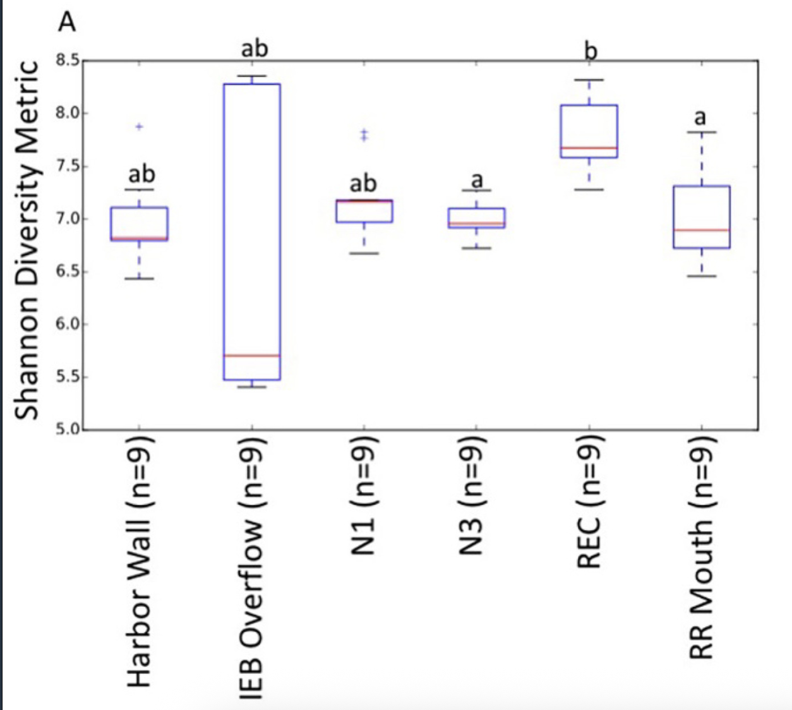
```


My alpha diversity results differ from the paper primarily in magnitude
of the Shannon index values. The original values ranged from 5-8.5 and
mine ranged from 3-6. The number of OTUs was not reported in the paper
so I can’t compare those to the number of ASVs that I had. Despite the
shift in scale, The spread and trends of the locations were consistent.
One of the most interesting similarities is that the location with the
highest range of Shannon index metrics is IEB Overflow which is the
storm water site. This could mean that the storm water site is variable
due to other effects such as precipitation or other anthropomorphic
disturbances.

The pairwise group patterns between sites were also similar with the
original paper. This could be due to the differences in the ranges of
each location. The overall range of each location seems to be smaller
than the paper’s, this could cause the differences in pairwise
groupings. The paper does have the Harbor Wall and N1 sites grouped with
IEB Overflow and REC where my results only grouped REC with IEB
Overflow.

## Beta Diversity

### Checking for over dispersion

**Original PS object**

``` r
(psadd::plot_mv(ps_mumu, log=TRUE, title = "Raw Mean-Variance Plot"))
```

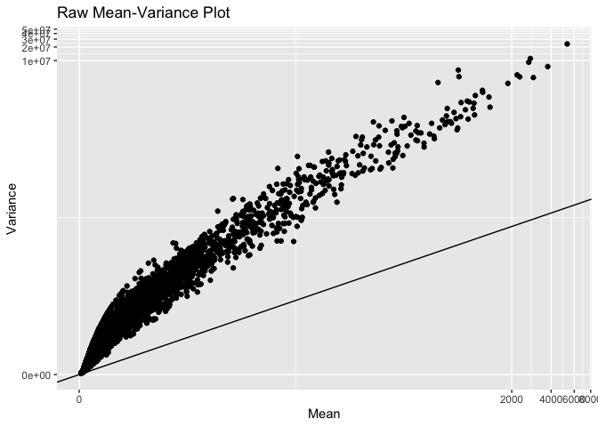<!-- -->

**CLR transformed PS object**

``` r
ps_clr <- microbiome::transform(ps_mumu, "clr")

(psadd::plot_mv(ps_clr, log=TRUE, title = "CLR Mean-Variance Plot"))
```

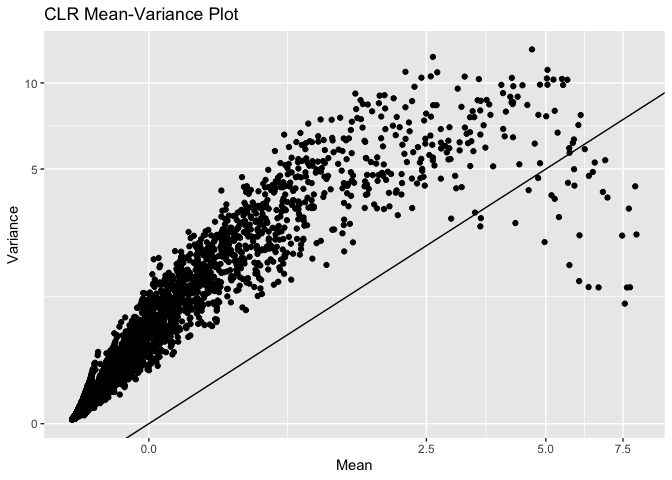<!-- -->

**VST transformed PS object**

``` r
# Convert to DeSeq object
dds <- phyloseq::phyloseq_to_deseq2(ps_mumu, ~1) 
```

    ## Loading required namespace: DESeq2

    ## converting counts to integer mode

``` r
dds <- DESeq2::estimateSizeFactors(dds)

# get dispersion (variance) estimates for the NB model
dds <- DESeq2::estimateDispersions(dds, fitType = "parametric") 
```

    ## gene-wise dispersion estimates

    ## mean-dispersion relationship

    ## final dispersion estimates

``` r
# check the fit - final estimates (blue) should shrink toward fitted estimates (red)
# if many outliers (large blue circles), consider additional QC steps on your data
DESeq2::plotDispEsts(dds)
```

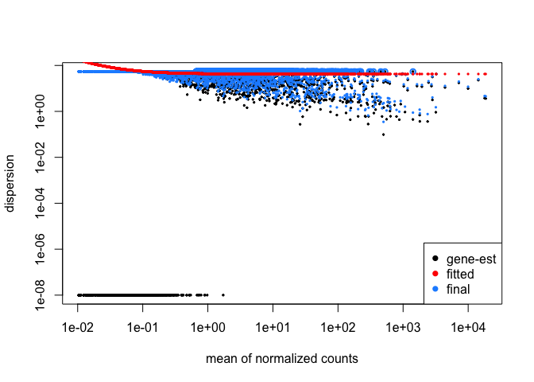<!-- -->

``` r
# get the transformed data
vsd<-DESeq2::getVarianceStabilizedData(dds)

# copy original ps object
ps_vst <- ps_mumu

# replace the original Otu_table with the transformed data
phyloseq::otu_table(ps_vst) <- phyloseq::otu_table(vsd, taxa_are_rows = TRUE)

(psadd::plot_mv(ps_vst, log=TRUE, title = "VST Mean-Variance Plot"))
```

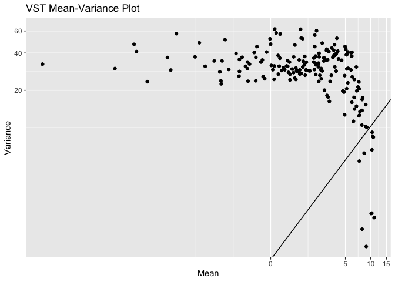<!-- -->

**Log10 transformed PS Object**

``` r
ps_log10 <- microbiome::transform(ps_mumu, "log10")
```

    ## Warning in microbiome::transform(ps_mumu, "log10"): OTU table contains zeroes. Using log10(1 + x)
    ## transform.

``` r
(psadd::plot_mv(ps_log10, log=TRUE, title = "Log10 Mean-Variance Plot"))
```

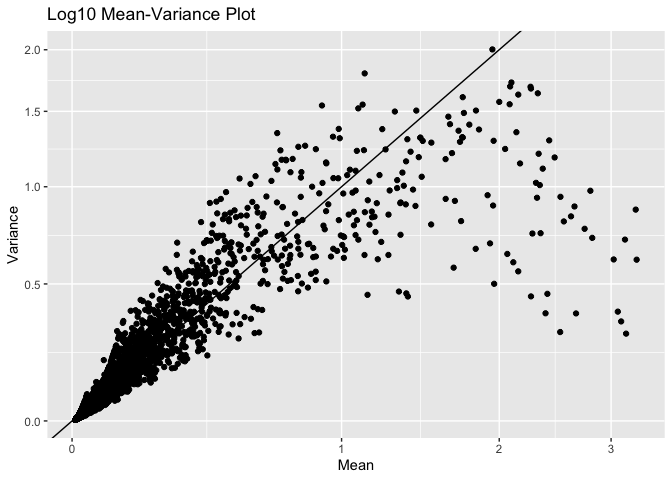<!-- -->

### Transformation Decision

After looking at mean-variance plots for raw, CLR, VST, and log10
tranformed data, the log10 transformed data looks the most stable. I
moved forward with that transformation with euclidean distance for the
PCoA.

### Run ordination via phyloseq::ordinate with option PCoA

``` r
ps_ord <- phyloseq::ordinate(ps_log10, method = "PCoA", distance = "euclidean")

phyloseq::plot_scree(ps_ord)
```

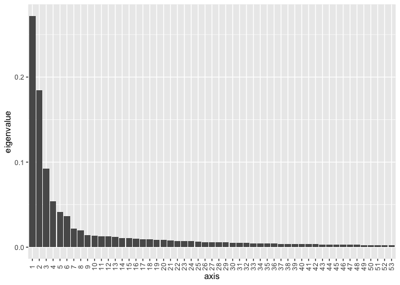<!-- -->

### Plot ordination results

``` r
phyloseq::plot_ordination(ps_log10, ps_ord, 
                          type="samples", 
                          color="env_local_scale", 
                          title="PCoA Log10 transformed Euclidean Samples") + 
                          geom_line() + 
                          geom_point(size=5) +
                          labs(color = "Location") +
                          theme_bw()
```

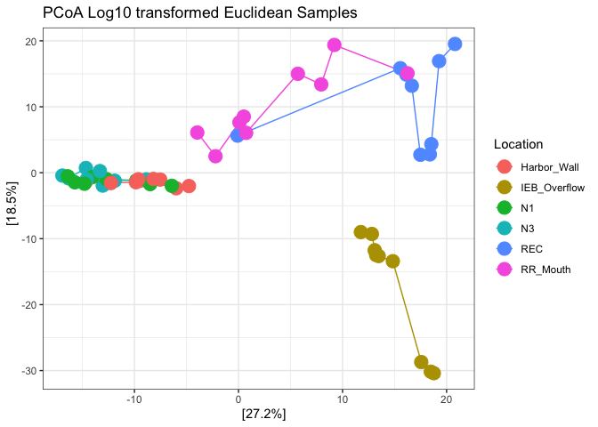<!-- -->

### Paper’s Beta Diversity Figure

``` r
knitr::include_graphics("figures/paper_beta.jpg")
```


The paper used a 3D PCoA with weighted Unifrac metrics while I did a
PCoA with euclidean distances of log10 transformed ASVs. The groupings
of the two figures are very similar. IEB Overflow has a distinct
grouping in both PCoAs along with the two river locations overlapping
(REC and RR Mouth). The surface waters closer to the lake all overlap as
well (N1, N3, and Harbor Wall).

## PERMANOVA with RRPP

### Prep data

``` r
# get distance matrix
asv <- read_csv("/Users/jennakraemer/Courses-MB588_BIT588-jkraeme/final_project/asv_table.csv")
asv <- as.data.frame(asv)
rownames(asv) <- asv$...1
asv$...1 <- NULL
# Make the rownames match
rownames(asv) <- sub("\\.fastq", "", rownames(asv))

# Get distance matrix for asv table
asv_d <- vegan::vegdist(asv, method="euclidean")

# ANOVA with distance matrix and locations
anova(vegan::betadisper(asv_d, SAM$env_local_scale))
```

    ## Analysis of Variance Table
    ## 
    ## Response: Distances
    ##           Df    Sum Sq  Mean Sq F value Pr(>F)
    ## Groups     5  79298410 15859682  1.7698 0.1371
    ## Residuals 48 430151422  8961488

Homogeneity of dispersion was met so I moved forward with RRPP.

### Run RRPP

``` r
otu.rrpp <- RRPP::lm.rrpp(asv_d ~ env_local_scale,
                   data = SAM, SS.type="III", 
                   print.progress = FALSE, 
                   seed="random", 
                   iter=999) # reduce if needed to run in class

anova(otu.rrpp, effect.type = "F", 
      error = c("Residuals"))
```

    ## 
    ## Analysis of Variance, using Residual Randomization
    ## Permutation procedure: Randomization of null model residuals 
    ## Number of permutations: 1000 
    ## Estimation method: Ordinary Least Squares 
    ## Sums of Squares and Cross-products: Type III 
    ## Effect sizes (Z) based on F distributions
    ## 
    ##                 Df         SS        MS     Rsq      F      Z Pr(>F)    
    ## env_local_scale  5 2870424965 574084993 0.55205 11.831 6.4554  0.001 ***
    ## Residuals       48 2329126406  48523467 0.44795                         
    ## Total           53 5199551371                                           
    ## ---
    ## Signif. codes:  0 '***' 0.001 '**' 0.01 '*' 0.05 '.' 0.1 ' ' 1
    ## 
    ## Call: RRPP::lm.rrpp(f1 = asv_d ~ env_local_scale, iter = 999, seed = "random",  
    ##     SS.type = "III", data = SAM, print.progress = FALSE)

The PERMANOVA with RRPP showed a significant difference between
locations which was the same result as the authors reported. Sample
location explains 55.2% of the variation in community composition.

## Differential Abundance

### Maaslin3

``` r
# Remove error causing columns
SAM$ReleaseDate <- NULL
SAM$create_date <- NULL
SAM_data$env_local_scale <- as.factor(SAM_data$env_local_scale)
SAM_data$env_local_scale <- relevel(SAM_data$env_local_scale, ref = "IEB_Overflow")


# get distance matrix
asv <- read_csv("/Users/jennakraemer/Courses-MB588_BIT588-jkraeme/final_project/asv_table.csv")
asv <- as.data.frame(asv)
rownames(asv) <- asv$...1
asv$...1 <- NULL
#Rename column headers
asv_table <- asv 
new_names <- paste0("ASV", seq_len(ncol(asv_table)))
colnames(asv_table) <- new_names

# Make the rownames match
rownames(asv_table) <- sub("\\.fastq$", "", rownames(asv_table))

maasfit <- maaslin3::maaslin3(input_data=asv_table, 
                           input_metadata=SAM_data, 
                           output="maasout", 
                           #formula = "~ Treatment + (1|Plot)",
                           #normalization="TSS",
                           #transform="LOG",
                           #standardize=TRUE, # metadata
                           fixed_effects="env_local_scale",
                           #random_effects="Plot",
                           max_significance = 0.00001, #FDR
                           correction = "BH",
                           min_prevalence=0.1,
                           #min_abundance=0
                           )

sigout  <- data.table::fread("./maasout/significant_results.tsv")
head(sigout)
```

### Visualize output

``` r
# Import maaslin3 table
res <- read.table("maasout/all_results.tsv", 
                  sep = "\t", header = TRUE)

tax <- as.data.frame(phyloseq::tax_table(ps_mumu))  # taxonomy table
tax$feature <- rownames(tax)            

# This is to create taxonomy labels for the figure that are similar to the figures LEfSe figure
# ChatGPT was used to help write the code to create the labels
res_tax <- res %>%
  left_join(tax, by = c("feature" = "feature")) %>%
  mutate(
    lowest = case_when(
      !is.na(Genus)  ~ Genus,
      !is.na(Family) ~ Family,
      !is.na(Order)  ~ Order,
      !is.na(Class)  ~ Class,
      TRUE ~ feature
    ),
    Taxon = paste(Class, lowest, sep = ".")
  )

res_tax <- res_tax %>% mutate(Taxon = make.unique(Taxon))

sig <- res_tax %>%
  filter(qval_individual < 0.00000001) %>%   # VERY important — sig must be rebuilt!
  arrange(desc(abs(coef))) %>%
  slice_head(n = 40)

sig$Taxon <- factor(sig$Taxon, levels = sig$Taxon)

# Plot to look at significant taxa determined from maaslin3
ggplot(sig, aes(x = coef, y = Taxon, fill = value)) +
  geom_col() +
  geom_vline(xintercept = 0, linetype = "dashed") +
  theme_bw() +
  labs(
    title = "MaAsLin3 Significant Associations",
    x = "Effect Size (Coefficient)",
    y = "Taxon",
    fill = "Location", 
    caption = "Reference site was IEB Overflow"
  ) +
  theme(axis.text.y = element_text(size = 7))
```

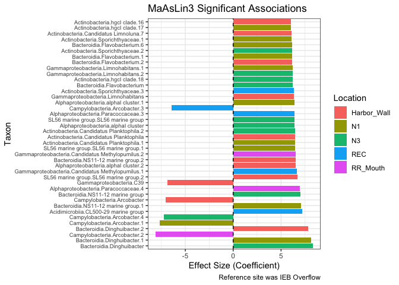<!-- -->

### LEfSe Figure from Paper

``` r
knitr::include_graphics("figures/paper_lefse.jpg")
```


In the paper, the authors main takeaway from the LEfSe results was that
Arcobacter and Flavobacterium were enriched in the IEB overflow samples
when compared to the other sites. I ran MaAsLin3 with IEB Overflow as
the reference level to see what taxa were significantly different in the
other locations. Arcobacter had negative coefficients between -6 and -8
for Harbor Wall, N1, N3, and RR Mouth. This aligns with the results from
the paper that IEB Overflow was enriched for Arcobacter but my results
reported that Flavobacterium was enriched in the N1, N3, and Harbor Wall
samples. Arcobacter is a genus that has potential waterborne pathogens
so this implies that the storm water samples could be a source of
contamination for the recreational water.

------------------------------------------------------------------------

# Discussion

The re-analysis did show some differences in results when compared to
the paper. The alpha diversity metrics in the re-analysis were much
lower across the board when compared to the alpha diversity in the
paper. The paper did not report exactly how they rarified the dataset or
how many OTUs they had but the higher alpha diversity measurements could
be due to how the data was processed. OTUs can inflate diversity metrics
because they do not take into sequencing errors into account. Noise from
errors can become characterizes as a new species. Another reason could
be because the rarefaction causes evenness to increase artificially
because of inflated proportional abundance of rare OTUs, removal of
singletons in ASVs, or poor error correction with OTUs causing more OTUs
present in samples.

The beta diversity methods yielded similar results with the IEB Overflow
samples being clustered far from the other samples, the Root River Mouth
and REC samples clustered together, and the N1, N3, and Harbor Wall
samples clustering close together. The each “type” of sample clustered
with other samples of its type which was directly related to their
location. These trends were seen on the PCoA from the paper even though
they used weighted UniFrac instead of log10 transformed euclidean
distances. This information could be used to explain taxonomic
differences in locations and which sites are more similar. The PERMANOVA
also yielded the same result that the sites are significantly different
from each other, which supports the hypothesis.

The differential abundance methods yielded somewhat different results.
The main takeaway from the authors was that Flavobacterium and
Arcobacter were enriched in the IEB Overflow samples but when I ran
maaslin3 with IEB Overflow as the reference site, flavobacterium was not
enriched in IEB but actually enriched in N1, N3, and Harbor Wall when
compared to IEB. I did get a similar result that Arcobacter was
enriched. This is very important in this context because the storm water
samples are enriched for potential pathogens. The beach and harbor wall
surface samples also contain potential fish pathogens that are
opportunistic to humans. In relation to recreational water quality, if
the beach water is mixing with water from the IEB Overflow, that could
lead to public health safety issues.

Overall my analysis of the samples brought higher resolution to the
taxonomy found in the samples, better pre-processing, error correction,
taxa grouping, and differential abundance methods. Some things to note
is that the number of samples used in this study for sequencing was
relatively small and more samples should be analyzed to get higher
confidence in the results. 16S sequencing can also only get down to
genus in most cases which does not particularly help with confidence of
the presence of potential pathogens. Shotgun sequencing could be a
another method explored for recreational water quality to get species
level results, although it has its own drawbacks such as lower
sensitivity.
